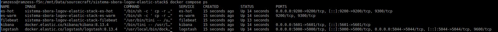
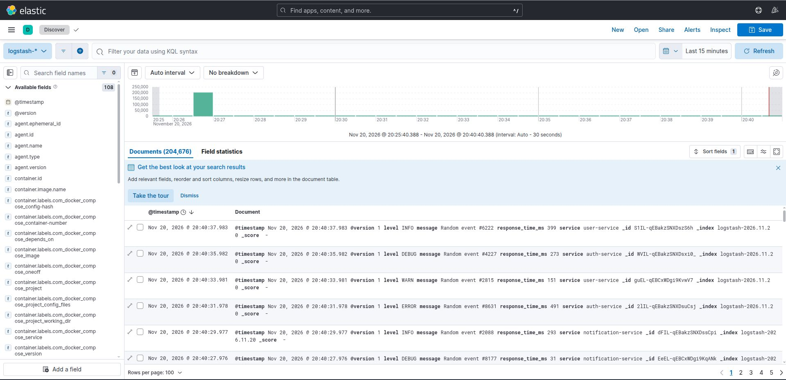

# Домашнее задание к занятию «Система сбора логов Elastic Stack» - Никифоров Роман Сергеевич

Дополнительные ссылки

При выполнении задания используйте дополнительные ресурсы:

    поднимаем elk в docker;
    поднимаем elk в docker с filebeat и docker-логами;
    конфигурируем logstash;
    плагины filter для logstash;
    конфигурируем filebeat;
    привязываем индексы из elastic в kibana;
    как просматривать логи в kibana;
    решение ошибки increase vm.max_map_count elasticsearch.

В процессе выполнения в зависимости от системы могут также возникнуть не указанные здесь проблемы.

Используйте output stdout filebeat/kibana и api elasticsearch для изучения корня проблемы и её устранения.
Задание повышенной сложности

Не используйте директорию help при выполнении домашнего задания.
Задание 1

Вам необходимо поднять в докере и связать между собой:

    elasticsearch (hot и warm ноды);
    logstash;
    kibana;
    filebeat.

Logstash следует сконфигурировать для приёма по tcp json-сообщений.

Filebeat следует сконфигурировать для отправки логов docker вашей системы в logstash.

В директории help находится манифест docker-compose и конфигурации filebeat/logstash для быстрого выполнения этого задания.

Результатом выполнения задания должны быть:

    скриншот docker ps через 5 минут после старта всех контейнеров (их должно быть 5);
    скриншот интерфейса kibana;
    docker-compose манифест (если вы не использовали директорию help);
    ваши yml-конфигурации для стека (если вы не использовали директорию help).

Задание 2

Перейдите в меню создания index-patterns в kibana и создайте несколько index-patterns из имеющихся.

Перейдите в меню просмотра логов в kibana (Discover) и самостоятельно изучите, как отображаются логи и как производить поиск по логам.

В манифесте директории help также приведенно dummy-приложение, которое генерирует рандомные события в stdout-контейнера. Эти логи должны порождать индекс logstash-* в elasticsearch. Если этого индекса нет — воспользуйтесь советами и источниками из раздела «Дополнительные ссылки» этого задания.
Как оформить решение задания

Выполненное домашнее задание пришлите в виде ссылки на .md-файл в вашем репозитории.

------

## Требования

- Docker Engine ≥ 24 и Docker Compose v2
- Не менее 4 ГБ свободной RAM (2 × Elasticsearch + Logstash + Kibana)
- Не менее 5 ГБ свободного места на диске под образы
- Linux-ядро с поддержкой `fuse-overlayfs` (или наличие пакета `fuse-overlayfs`)
- Параметр ядра `vm.max_map_count` ≥ 262144

## Особенности реализации

### 1. Нехватка места на системном разделе

**Проблема:** при скачивании образов Elasticsearch/Kibana возникла ошибка
`no space left on device` в `/var/lib/containerd`.

**Решение:** перенёс хранилище Docker и containerd на раздел `/mnt/Data`:

```json
{
  "data-root": "/mnt/Data/docker-storage/docker"
}
```

и в `/etc/containerd/config.toml`:
```toml
root = '/mnt/Data/docker-storage/containerd'
```

### 2. NTFS не поддерживает overlayfs

**Проблема:** при запуске контейнеров:
`failed to mount ... overlay ... invalid argument`.

**Причина:** у меня раздел, хранящий файлы проект — NTFS. Обычный `overlay2` требует поддержки `xattr` и POSIX-прав, которых у NTFS нет.

**Решение:** установил `fuse-overlayfs` и переключил Docker на него:

```json
{
  "storage-driver": "fuse-overlayfs"
}
```

### 3. Ошибка `can not run elasticsearch as root`

**Проблема:** кастомный `entrypoint` запускал Elasticsearch от `root`, а сервис отказывается работать с такими привилегиями.

**Решение:** внутри `entrypoint` после копирования конфигов выполняю смену пользователя через `chroot --userspec=1000:0`:

```yaml
entrypoint: >
  /bin/sh -c "
  cp -r /tmp/es-config/. /usr/share/elasticsearch/config/ &&
  chown -R elasticsearch:elasticsearch /usr/share/elasticsearch/config &&
  exec chroot --userspec=1000:0 / /usr/share/elasticsearch/bin/elasticsearch
  "
```

### 4. `Missing logging config file`

**Проблема:** при монтировании `tmpfs` поверх `/usr/share/elasticsearch/config` стандартный `log4j2.properties` теряется.

**Решение:** в `Dockerfile` создаю резервную копию дефолтных конфигов в `/tmp/es-config`:

```dockerfile
RUN mkdir -p /tmp/es-config && \
    cp -r /usr/share/elasticsearch/config/. /tmp/es-config/
COPY --chown=elasticsearch:elasticsearch elasticsearch.yml /tmp/es-config/elasticsearch.yml
```

При старте `entrypoint` копирует всё содержимое `/tmp/es-config` в `tmpfs`.

### 5. NTFS и права на bind-mount файлов

**Проблема:** Filebeat отказывается читать конфиг с правами `777`, а Elasticsearch не может сделать `chown` на смонтированных с NTFS файлах.

**Решение:** включил конфиги в образы через `Dockerfile` (там права выставляются на слое `fuse-overlayfs`), а для Filebeat добавил флаг `--strict.perms=false`.

### 6. Отсутствие `gosu` в образе

**Проблема:** стандартная утилита `gosu` в образе Elasticsearch 8.13.4 отсутствует.

**Решение:** заменил на `chroot --userspec=1000:0`.

### 7. Данные Elasticsearch в `tmpfs`

Поскольку `data`-директория Elasticsearch тоже не может работать на NTFS, она смонтирована в `tmpfs` (RAM). 
**Следствие:** индексы не сохраняются при перезапуске контейнеров. Для учебного задания это приемлемо, но в реальной практике нужно использовать раздел с поддержкой POSIX (ext4/xfs).

## Запуск


### 1. Запуск основного стека (5 контейнеров)

```bash
docker compose up -d
```

Через ~1 минуту проверьте статус:

```bash
docker compose ps
```

Все пять контейнеров (`es-hot`, `es-warm`, `logstash`, `kibana`, `filebeat`) должны быть в состоянии `Up`.

### 2. Запуск dummy-приложения

Оно вынесено в отдельный профиль, чтобы не нарушать требование «5 контейнеров»:

```bash
docker compose --profile dummy up -d dummy-app
```

Dummy-приложение генерирует случайные JSON-события и отправляет их в Logstash по TCP (порт 5000). Дополнительно оно печатает их в stdout, откуда их забирает Filebeat.
  
------

  Ответы:
  
  [docker-compose.yml](docker-compose.yml)
  
  [/elasticsearch/es-warm/elasticsearch.yml](/elasticsearch/es-warm/elasticsearch.yml)
  
  [/elasticsearch/es-hot/elasticsearch.yml](/elasticsearch/es-hot/elasticsearch.yml)
  
  [/filebeat/filebeat.yml](/filebeat/filebeat.yml)
  
  [/dummy-app/app.py](/dummy-app/app.py)
  
  [/logstash/pipeline/logstash.conf](/logstash/pipeline/logstash.conf)
  
  

  

------
